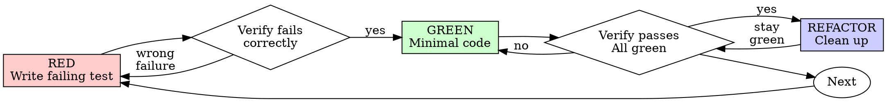

# Test-Driven Development (TDD)

## Overview

Prefer writing the test first, watching it fail, and writing minimal code to
pass when that sequence is proportional and clarifies the contract.

**Core principle:** Regression evidence must exercise the changed behavior and
fail if the correction is reverted; test-first is a preferred technique, not a
universal phase gate.

## When to Use

Use this skill for:
- New features
- Bug fixes
- Behavior changes
- Refactoring that changes behavior

**Behavior-preserving refactoring:**
- Start from green characterization or regression coverage
- Keep coverage green before and after the refactor
- Do not require a deliberately failing test when behavior is unchanged

Small, well-understood, configuration, generated, or disposable changes may
use proportional focused proof without a separate failing-test phase.

## Regression-proof invariant

```
NO NEW OR CHANGED BEHAVIOR IS COMPLETE WITHOUT REGRESSION EVIDENCE
```

Test-first is the preferred technique for non-trivial behavior when it clarifies
the contract. Characterization tests are appropriate before behavior-preserving
refactors. For a small, well-understood change, focused regression proof may be
written alongside or after the implementation, but it must exercise the
failure or behavior and fail if the correction is reverted.

## Preferred Red-Green-Refactor

Use this cycle when the behavior is non-trivial or the contract is unclear.
For smaller changes, retain the regression-proof invariant with the smallest
direct evidence that proves it.



### RED - Write Failing Test

Write one minimal test showing what should happen.

<Good>
```typescript
test('retries failed operations 3 times', async () => {
  let attempts = 0;
  const operation = () => {
    attempts++;
    if (attempts < 3) throw new Error('fail');
    return 'success';
  };

  const result = await retryOperation(operation);

  expect(result).toBe('success');
  expect(attempts).toBe(3);
});
```
Clear name, tests real behavior, one thing
</Good>

<Bad>
```typescript
test('retry works', async () => {
  const mock = jest.fn()
    .mockRejectedValueOnce(new Error())
    .mockRejectedValueOnce(new Error())
    .mockResolvedValueOnce('success');
  await retryOperation(mock);
  expect(mock).toHaveBeenCalledTimes(3);
});
```
Vague name, tests mock not code
</Bad>

**Requirements:**
- One behavior
- Clear name
- Real code (no mocks unless unavoidable)

### Verify RED - Watch It Fail

Use the failing-test step when it adds signal; do not add instrumentation or a
phase solely to satisfy this diagram.

```bash
npm test path/to/test.test.ts
```

Confirm:
- Test fails (not errors)
- Failure message is expected
- Fails because feature missing (not typos)

**Test passes?** You're testing existing behavior. Fix test.

**Test errors?** Fix error, re-run until it fails correctly.

### GREEN - Minimal Code

Write simplest code to pass the test.

<Good>
```typescript
async function retryOperation<T>(fn: () => Promise<T>): Promise<T> {
  for (let i = 0; i < 3; i++) {
    try {
      return await fn();
    } catch (e) {
      if (i === 2) throw e;
    }
  }
  throw new Error('unreachable');
}
```
Just enough to pass
</Good>

<Bad>
```typescript
async function retryOperation<T>(
  fn: () => Promise<T>,
  options?: {
    maxRetries?: number;
    backoff?: 'linear' | 'exponential';
    onRetry?: (attempt: number) => void;
  }
): Promise<T> {
  // YAGNI
}
```
Over-engineered
</Bad>

Don't add features, refactor other code, or "improve" beyond the test.

### Verify GREEN - Watch It Pass

Use this check whenever the test-first cycle was selected; otherwise run the
smallest focused regression proof that establishes the invariant.

```bash
npm test path/to/test.test.ts
```

Confirm:
- Test passes
- Other tests still pass
- Output pristine (no errors, warnings)

**Test fails?** Fix code, not test.

**Other tests fail?** Fix now.

### REFACTOR - Clean Up

After green only:
- Remove duplication
- Improve names
- Extract helpers

Keep tests green. Don't add behavior.

### Repeat

Next failing test for next feature.

## Good Tests

| Quality | Good | Bad |
|---------|------|-----|
| **Minimal** | One thing. "and" in name? Split it. | `test('validates email and domain and whitespace')` |
| **Clear** | Name describes behavior | `test('test1')` |
| **Shows intent** | Demonstrates desired API | Obscures what code should do |

## Why Order Matters

**"I'll write tests after to verify it works"**

Tests written after code pass immediately. Passing immediately proves nothing:
- Might test wrong thing
- Might test implementation, not behavior
- Might miss edge cases you forgot
- You never saw it catch the bug

Test-first forces you to see the test fail, proving it actually tests something.

**"I already manually tested all the edge cases"**

Manual testing is ad-hoc. You think you tested everything but:
- No record of what you tested
- Can't re-run when code changes
- Easy to forget cases under pressure
- "It worked when I tried it" ≠ comprehensive

Automated tests are systematic. They run the same way every time.

**"Deleting X hours of work is wasteful"**

Do not rewrite working code merely to satisfy a test-first ceremony. Add the
smallest regression evidence that would fail if the correction were reverted;
rewrite only when the implementation itself is unsafe or the contract cannot
be tested clearly.

**"TDD is dogmatic, being pragmatic means adapting"**

Adapt the technique, not the evidence requirement. Test-first is preferred for
non-trivial or unclear behavior; focused characterization, boundary, or
regression proof is enough for small, well-understood, configuration,
generated, or disposable changes.

**"Tests after achieve the same goals - it's spirit not ritual"**

Tests-after can establish the regression-proof invariant when the test exercises
the changed behavior and fails if the correction is reverted. Test-first still
helps discover the contract before implementation, so prefer it when that
benefit is material.

## Common Rationalizations

| Excuse | Reality |
|--------|---------|
| "Too simple to test" | Use the smallest focused proof that catches reversion when the change affects behavior. |
| "I'll test after" | Acceptable only when the resulting proof exercises changed behavior and fails on reversion. |
| "Tests after achieve same goals" | Test-first is preferred for contract discovery; tests-after can still provide regression evidence. |
| "Already manually tested" | Manual evidence may supplement but does not replace repeatable regression proof for changed behavior. |
| "Need to explore first" | Explore when useful, then preserve the smallest evidence that proves the final behavior. |
| "Test hard = design unclear" | Simplify the design when useful, but do not impose test-first ceremony on trivial work. |
| "Existing code has no tests" | Add focused coverage for the changed behavior when the change is material. |

## Red Flags

- No repeatable evidence for changed behavior
- Evidence does not exercise the changed boundary
- Evidence passes even when the correction is reverted
- Test-first was selected but its failure was never checked
- Edge cases or failure paths are omitted when they are material

## Example: Bug Fix

**Bug:** Empty email accepted

**RED**
```typescript
test('rejects empty email', async () => {
  const result = await submitForm({ email: '' });
  expect(result.error).toBe('Email required');
});
```

**Verify RED**
```bash
$ npm test
FAIL: expected 'Email required', got undefined
```

**GREEN**
```typescript
function submitForm(data: FormData) {
  if (!data.email?.trim()) {
    return { error: 'Email required' };
  }
  // ...
}
```

**Verify GREEN**
```bash
$ npm test
PASS
```

**REFACTOR**
Extract validation for multiple fields if needed.

## Verification Checklist

Before marking work complete:

- [ ] Changed behavior has proportional regression evidence
- [ ] Test-first was used when the contract was non-trivial, unclear, or its discovery benefit was material
- [ ] When test-first was selected, each test failed for the expected reason before implementation
- [ ] Wrote the smallest code that satisfies the evidence
- [ ] All tests pass
- [ ] Output pristine (no errors, warnings)
- [ ] Tests use real code (mocks only if unavoidable)
- [ ] Edge cases and errors covered

If the chosen proof does not establish the regression-proof invariant, add the
smallest missing evidence before claiming completion.

## When Stuck

| Problem | Solution |
|---------|----------|
| Don't know how to test | Write wished-for API. Write assertion first. Ask your human partner. |
| Test too complicated | Design too complicated. Simplify interface. |
| Must mock everything | Code too coupled. Use dependency injection. |
| Test setup huge | Extract helpers. Still complex? Simplify design. |

## Debugging Integration

Bug found? Prefer a failing reproducer when the behavior is non-trivial or
unclear. For a small, well-understood fix, add the smallest focused regression
proof alongside or after the implementation. Never fix a behavior bug without
repeatable evidence that would fail if the fix were reverted.

For material backend behavior, TDD owns implementation loop while `backend-verification` owns direct boundary, failure, state, dependency, contract, and representative-operation evidence.

## Testing Anti-Patterns

When adding mocks or test utilities, read @testing-anti-patterns.md to avoid common pitfalls:
- Testing mock behavior instead of real behavior
- Adding test-only methods to production classes
- Mocking without understanding dependencies

## Final Rule

```
Production code → regression evidence exists and passes
Test-first → preferred when it reduces uncertainty or clarifies the contract
```
